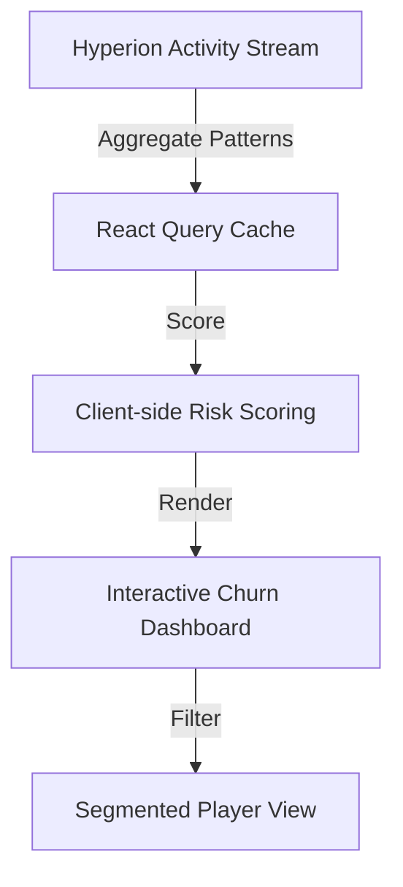

# wax-player-churn-predictor — Player Churn Prediction & Retention Analytics

> **Status:** 🔒 Private (In Development) | Target Public Release: August 2026  
> **Category:** Gaming & Metagame  
> **Parent Catalog:** [pixel-journey/wax-ecosystem-blueprint-catalog](https://github.com/pixel-journey/wax-ecosystem-blueprint-catalog)

**One-sentence goal:** A predictive analytics dashboard that analyzes on-chain activity patterns, engagement velocity, and behavioral signals to estimate player retention risk and churn probability, helping gaming projects on WAX proactively improve retention.

---

## 1. Overview & Goal

This blueprint turns raw on-chain activity into actionable retention insights. Projects can see who is at risk of leaving and why.

- **Why it matters for WAX:** Gaming projects live or die by retention. Beautiful, data-driven churn prediction helps creators keep players engaged longer.
- **Public infrastructure only:** Hyperion for activity history, AtomicAssets for asset holdings, client-side ML-lite models or simple scoring rules. No custom contracts.
- **Target users:** Game developers, community managers, analysts, retention teams.
- **Success metrics:** "See churn risk scores for players in <5s", "Identify at-risk segments with clear behavioral reasons", "Enable proactive retention campaigns".

---

## 2. Concepts & Inspiration

- **Core concepts:** Churn signals include declining activity frequency, reduced asset interactions, shorter session-like patterns (via action clustering), and dropping engagement velocity. Simple scoring or lightweight models can predict risk.
- **Pain points:** Most projects only see raw numbers. They lack beautiful tools to predict who will leave and intervene early.
- **Inspirations:** SaaS churn dashboards (e.g. in Mixpanel, Amplitude), game analytics tools, modern retention platforms. Web3: on-chain behavioral signals + beautiful predictive UI.
- **Cross-references:** Complements `wax-temporal-activity-heatmap`, `wax-organic-activity-fingerprinter`, and other forensics/gaming blueprints. Fits with metagame and analytics tools.

---

## 3. Design Specifications (Pixel Journey Standards)

### 3.1 Visual & Interaction Design
- Clean dashboard with risk score distribution (low/medium/high) and player segments.
- Main visual: Interactive table or cards with risk scores, trend arrows, and key behavioral flags.
- Sidebar: Filters for time range, asset type, activity level.
- Micro-interactions: Hover shows detailed behavioral breakdown; click opens player profile modal.
- Responsive: Excellent on desktop for analysis; mobile-friendly summary view.

### 3.2 Key Views / Components
- `ChurnDashboard.tsx` — Main overview with risk distribution and top at-risk players.
- `PlayerRiskCard.tsx` — Individual player card with score, trend, and flags.
- `BehavioralBreakdown.tsx` — Detailed view of signals contributing to risk score.
- `RetentionActions.tsx` — Suggested interventions (for project admins).
- `TrendChart.tsx` — Historical churn risk trends.

### 3.3 Accessibility (A11y) & Inclusive Design
- WCAG 2.2 AA: High contrast scores, keyboard navigation, screen reader announcements for risk changes.
- Colorblind-safe palettes with patterns.
- Data table fallback for all visualizations.

### 3.4 Performance & Optimization Targets
- Efficient aggregation of Hyperion data with caching.
- Fast scoring calculations (client-side or lightweight).
- Responsive design with progressive enhancement.

---

## 4. Technical Architecture

### 4.1 Core Tech Stack
- Next.js 15 + TypeScript + Tailwind + shadcn/ui + Recharts
- @tanstack/react-query
- Hyperion for activity history and patterns
- Simple scoring algorithm or lightweight client-side model (e.g. weighted signals)
- date-fns for time-based features

### 4.2 Data Flow Diagram


### 4.3 Folder Structure
```
app/
├── (dashboard)/page.tsx
├── components/
│   ├── churn/
│   │   ├── ChurnDashboard.tsx
│   │   └── PlayerRiskCard.tsx
│   └── breakdown/
│       └── BehavioralBreakdown.tsx
├── hooks/useChurnPrediction.ts
├── lib/wax/
│   ├── hyperion-activity.ts
│   └── churn-scorer.ts
└── types/churn.ts
```

### 4.4 Security & Privacy
- Aggregate and anonymized views by default. Individual player views for project admins only (via optional auth).
- Clear disclaimers on data sources.

---

## 5. Implementation Examples & Code Snippets

**Core churn scoring hook**
```ts
// hooks/useChurnPrediction.ts
export function useChurnPrediction(projectId: string) {
  return useQuery({
    queryKey: ['churn', projectId],
    queryFn: async () => {
      const activity = await fetchActivityPatterns(projectId);
      return calculateChurnRisk(activity);
    }
  });
}
```

**Simple scoring example**
```ts
function calculateChurnRisk(activity: any) {
  const score = /* weighted combination of recency, frequency, engagement depth */
  return { score, riskLevel: getRiskLevel(score), flags };
}
```

---

## 6. Demo & Testing
- Mock data with realistic player segments and risk scores.
- Live mode with real project activity (anonymized where needed).
- Interaction tests: filtering, player detail, trend views.
- Scoring accuracy tests with historical data.

---

## 7. Roadmap
Phases: Data aggregation and scoring engine → Dashboard UI with cards and filters → Polish, a11y, retention suggestions → full documentation.

Future: ML model integration (optional), automated alerts, cohort comparison views.

---

## 8. Visual References
> Clean SaaS analytics dashboard meets beautiful Web3 explorer. Risk scores with clear visual hierarchy, subtle trend arrows, professional yet approachable aesthetic. Reference: modern retention dashboards (Amplitude, Mixpanel style) + Web3 analytics polish.

---

## 9. Related Blueprints
- `wax-temporal-activity-heatmap` & `wax-organic-activity-fingerprinter` — Behavioral signal sources.
- Other gaming and analytics blueprints.

---

## 10. License & Credits
MIT. Built for smarter retention in WAX gaming projects.

**Pixel Journey — Beautiful interfaces for public blockchain data.**
